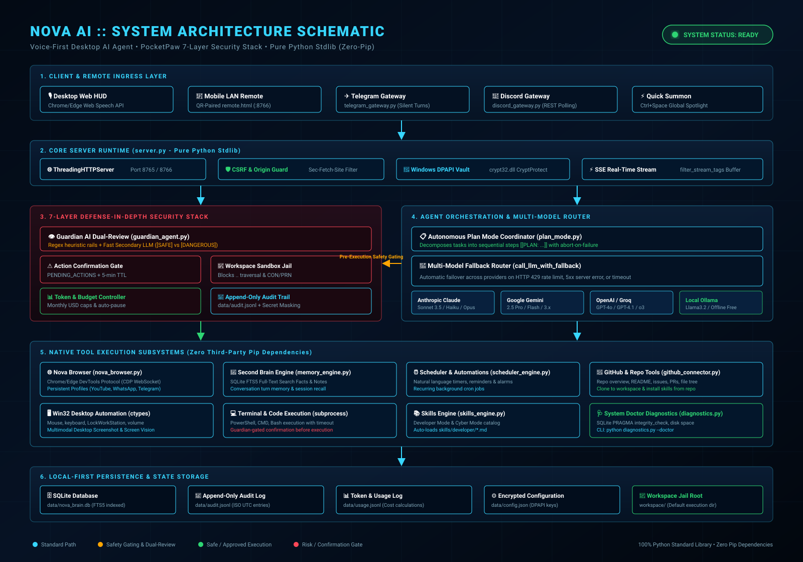

# 🌌 Nova AI — Desktop & Edge Autonomous Agent Platform

[-blue.svg)](file:///d:/Developer%20Mode%20on/nova-ai/test_phase4_integration.py)
[-brightgreen.svg)](file:///d:/Developer%20Mode%20on/nova-ai/BUGS.md)
[](file:///d:/Developer%20Mode%20on/nova-ai/guardian_agent.py)
[](file:///d:/Developer%20Mode%20on/nova-ai/architecture_diagram.svg)
[](#license)

**Nova AI** is an extensible, voice-first autonomous desktop agent and operating system assistant inspired by J.A.R.V.I.S. It bridges natural multimodal conversation with real OS-level automation, headless browser control, SQLite knowledge retrieval, GitHub integrations, and multi-channel remote gateways (Web, Mobile QR, Telegram, Discord).

Engineered with a **strict Zero-Pip dependency design**, Nova AI runs 100% on the standard Python runtime (`3.8+`) with zero third-party packages to install.

---

## 🏛️ System Architecture

Nova AI decouples presentation, orchestration, tool execution, and state persistence into four hardened architectural tiers:



### Native Architecture Blueprint

```mermaid
flowchart TD
    subgraph UI["1. Gateway & Interface Plane"]
        WebHUD["Web Desktop HUD (:8765)\n(Particle Core, Voice Barge-In, Action HUD)"]
        MiniHUD["Mini Floating HUD\n(Screen-Docked Widget)"]
        MobileRemote["Mobile Web Remote (:8766)\n(QR-Paired, Token Guarded)"]
        TelegramBot["Telegram Gateway\n(Polling, User Whitelist)"]
        DiscordBot["Discord Gateway\n(WebSocket/REST, Whitelist)"]
    end

    subgraph Core["2. Core Agent Engine & Safety Rails"]
        Router["HTTP & Gateway Dispatcher"]
        Persona["Dual Persona Engine\n(Developer Mode / Cyber Mode)"]
        Fallback["Multi-Tier LLM Fallback\n(Gemini -> Claude -> OpenAI -> Ollama)"]
        Guardian["Guardian AI Safety Reviewer\n(Pre-execution Regex & LLM Confirmation)"]
        PlanEngine["Autonomous Plan Mode\n(Multi-Turn Step Execution)"]
    end

    subgraph Execution["3. Execution Engine & Tool Bus"]
        Win32OS["Win32 Automation\n(Apps, Volume, Media, Keys, Window Context)"]
        TerminalExec["Subprocess Terminal\n(CMD, PowerShell, Python, Node.js)"]
        CDPBrowser["Nova Browser (CDP)\n(DOM Click, Type, Scroll, Persistent Profile)"]
        GitHubConn["GitHub Connector\n(Issues, PRs, Tree, Traversal-Safe Clone)"]
        SecondBrain["Second Brain\n(SQLite + Pure Python BM25 Semantic Search)"]
        AutoScheduler["Task Scheduler\n(Cron, Interval, Timers, Hardware Watchdog)"]
    end

    subgraph Storage["4. Persistence & Security Layer"]
        DPAPI["Windows DPAPI Hardware Encryption\n(API Keys & Master Tokens)"]
        AuditLog["Audit Logger\n(audit.jsonl Append-Only Security Trail)"]
        UsageLedger["Token Usage Ledger\n(usage.jsonl & Monthly USD Budget Cap)"]
        Diagnostics["Self-Healing Diagnostics\n(SQLite Integrity, Disk, Environment)"]
    end

    UI --> Router
    Router --> Guardian
    Guardian --> Persona
    Persona --> Fallback
    Fallback --> PlanEngine
    PlanEngine --> Execution
    Execution --> Storage
```



---

## ✨ Key Features & Capabilities

### 🎙️ Hands-Free Voice & Natural Conversation
- **Voice Wake-Word Activation**: Say *"Hey Nova"*, *"Nova"*, or *"Hey Jarvis"* to summon listening mode hands-free.
- **Natural Voice Barge-In**: Instant interruption — speaking immediately cuts off TTS audio and switches back to listening.
- **Multilingual Synthesis**: Native bidirectional voice interaction in English, বাংলা (Bengali), हिंदी (Hindi), اردو (Urdu), Español, Français, Deutsch, etc.
- **Mini Floating HUD**: Collapse the dashboard into an ultra-compact floating widget docked in the corner of your screen over games or IDEs.

### 🛡️ Guardian AI Dual-Review Safety Rails
- **Pre-execution Command Review**: Evaluates destructive commands (`rm -rf`, disk format, registry edits) before execution.
- **Time-Bounded Security Confirmations**: Sensitive system actions generate cryptographic tokens requiring explicit user approval (`/api/confirm`).
- **Hardware-Backed DPAPI Encryption**: Automatically protects API keys and secrets on disk using Windows Data Protection API (DPAPI).
- **DNS Rebinding & CSRF Protection**: Binds strictly to `127.0.0.1`, enforces exact port/host validation, and blocks cross-site fetch headers.

### 🌐 Multi-Channel Gateways (Work from Anywhere)
- **Mobile QR Remote (`:8766`)**: Scan a one-time QR code with your phone to control Nova over Wi-Fi without cloud relay servers. Uses a 5-minute single-use pairing code exchanged for a per-device authorization token (`Authorization: Bearer <token>`, never in URL query strings). Paired devices can be inspected and revoked at any time from Nova's Mobile panel.
- **Telegram Bot Gateway**: Remote control Nova securely from Telegram with chat ID whitelist verification and silent desktop execution.
- **Discord Bot Gateway**: Full bot gateway supporting `!nova <prompt>` and interactive `!confirm <token>` workflows.

### 🧠 Second Brain Knowledge Base & Planning
- **SQLite Semantic Storage**: Pure-Python BM25 ranking algorithm providing fast local document retrieval without external vector databases (`data/nova_brain.db`).
- **Autonomous Multi-Turn Plan Mode**: Breaks complex user requests into structured, executable milestones (`[[PLAN: goal | step1; step2]]`).
- **Self-Healing Code Agent**: Automatically detects syntax or traceback errors and iterates up to 2 times to self-heal and repair code bugs.

### 🐙 GitHub Connector & Skill Ecosystem
- **Repository Exploration**: Query repository metadata, read READMEs, view file trees, and inspect code directly via tool tags:
  ```text
  [[GITHUB: owner/repo | issues]]
  [[GITHUB: owner/repo | tree]]
  [[GITHUB: owner/repo | file:src/index.js]]
  ```
- **Traversal-Safe Cloner & Zip Slip Protection**: Safely clones repositories and installs custom skills into the agent runtime with path-containment validation.

### 📊 Token Usage Ledger & Budget Control
- **Per-Turn Token Tracking**: Computes prompt/candidate token metrics and estimated USD costs per model tier.
- **Monthly Budget Enforcement**: Set a monthly budget ceiling (e.g. `\$10.00`). When exceeded, non-critical LLM calls are safely paused.

---

## 🚀 Quick Start

### 1. Prerequisites
- **Python 3.8+** (Windows, macOS, or Linux). Ensure *"Add Python to PATH"* is checked during installation.
- Recommended browser: **Google Chrome** or **Microsoft Edge** (for HTML5 Speech Recognition and CDP automation).

### 2. Launch Nova AI
```powershell
# Clone the repository
git clone https://github.com/nickshane225-source/Nova-Ai.git
cd Nova-Ai

# Run on Windows
.\run.bat

# Or run directly via Python
python server.py
```

Nova AI will start on `http://127.0.0.1:8765`. Your browser will open automatically.

### 3. Configure Your AI Provider
Click **Settings** on the left navigation bar, choose your preferred provider, and paste your API key:
- **Google Gemini**: Free API key from [Google AI Studio](https://aistudio.google.com/apikey) (Recommended: `gemini-2.0-flash`).
- **Anthropic Claude**: API key from [Anthropic Console](https://console.anthropic.com/) (Recommended: `claude-3-5-sonnet-latest`).
- **OpenAI-Compatible**: OpenAI, Groq, OpenRouter, or DeepSeek API key and base URL.
- **Ollama / LM Studio**: 100% free and local. Install [Ollama](https://ollama.com/), run `ollama pull llama3.2`, and select *Ollama* in Settings.

---

## 🛠️ Tool & Action Reference

Nova AI autonomously executes system operations using declarative action tags:

| Skill Tag | Action | Example |
|:---|:---|:---|
| `[[OPEN_APP: name]]` | Open allowlisted desktop application | `[[OPEN_APP: notepad]]` |
| `[[CLOSE_APP: name]]` | Gracefully close application process | `[[CLOSE_APP: chrome]]` |
| `[[VOLUME: level]]` | Set master volume or mute/unmute | `[[VOLUME: 50%]]` |
| `[[SCREENSHOT]]` | Capture primary screen & open viewer | `[[SCREENSHOT]]` |
| `[[CMD: command]]` | Run safe Windows Command Prompt command | `[[CMD: ipconfig /all]]` |
| `[[POWERSHELL: command]]` | Execute PowerShell script command | `[[POWERSHELL: Get-Service]]` |
| `[[WRITE_FILE: path \| content]]` | Create/write file inside workspace | `[[WRITE_FILE: script.py \| print(1)]]` |
| `[[EDIT_FILE: path \| search \| rep]]` | Surgical regex search & replace edit | `[[EDIT_FILE: script.py \| print(1) \| print(2)]]` |
| `[[RUN_CODE: lang \| code]]` | Run Python, Node.js or Bash script | `[[RUN_CODE: python \| print('OK')]]` |
| `[[PLAN: title \| steps]]` | Initiate autonomous multi-step plan | `[[PLAN: Setup \| step 1; step 2]]` |
| `[[NOTE: text]]` | Save note to SQLite Second Brain | `[[NOTE: API secret is rotated on Monday]]` |
| `[[SEARCH_NOTES: query]]` | BM25 semantic search across notes | `[[SEARCH_NOTES: secret rotation]]` |
| `[[GITHUB: repo \| action]]` | GitHub issues, trees, files, clone | `[[GITHUB: pocketpaw/pocketpaw \| issues]]` |
| `[[BROWSER_CLICK: selector]]` | Click DOM element in Nova Browser | `[[BROWSER_CLICK: #submit-btn]]` |
| `[[SMART_HOME: url \| method \| body]]` | LAN IoT webhook dispatch | `[[SMART_HOME: http://192.168.1.50/light \| POST \| {"on":true}]]` |
| `[[BRIEFING]]` | Generate morning weather & news briefing | `[[BRIEFING]]` |

---

## 🧪 Quality & Verification Suite

Nova AI features an exhaustive regression and fuzzing harness covering all endpoints, edge cases, and safety bounds:

```powershell
# Run the full Python test suite (30 modules, 198 tests)
python -m unittest discover -p "test_*.py"

# Run the live Node.js Web Speech API regression harness
node test_voice_regression.js
```

### Test Pass Score: 100% (204 / 204 Tests)
- **Security & Sandboxing:** Path traversal blocked, Windows device names (`CON`, `NUL`, etc.) rejected, CSRF/DNS rebinding defended.
- **Resilience:** Automatic 2-step code self-healing loop, multi-tier LLM failover, rate-limit backoff.
- **Zero-Pip Integrity:** Proves `server.py` and all companion engines import exclusively from the standard library.

Detailed reproduction steps, root causes, and verification notes are documented in [BUGS.md](file:///d:/Developer%20Mode%20on/nova-ai/BUGS.md).

---

## 🔒 Security & Privacy Model

- **Local-First Architecture:** The HTTP server binds exclusively to `127.0.0.1` and blocks requests with invalid `Host` or cross-site `Sec-Fetch-Site` headers.
- **Zero Telemetry:** Nova AI collects zero analytics, telemetry, or user logs. All chat histories, notes, and metrics remain on your local drive.
- **Credential Storage:** API keys and sensitive tokens are encrypted using Windows DPAPI (`CryptProtectData`) before being written to disk.
- **Isolated Workspace:** File read/write and script execution are jailed inside the `./workspace/` directory by default, preventing unintended modifications to host operating system files.

---

## 📄 License

This project is licensed under the MIT License — see the [LICENSE](LICENSE) file for details.
