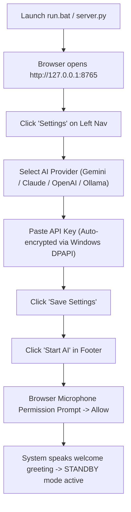
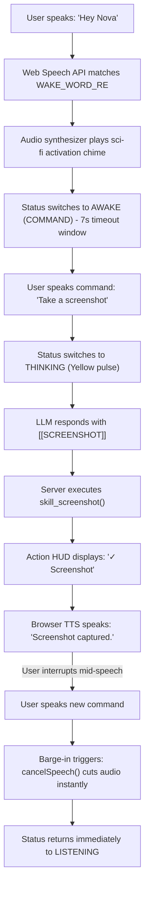
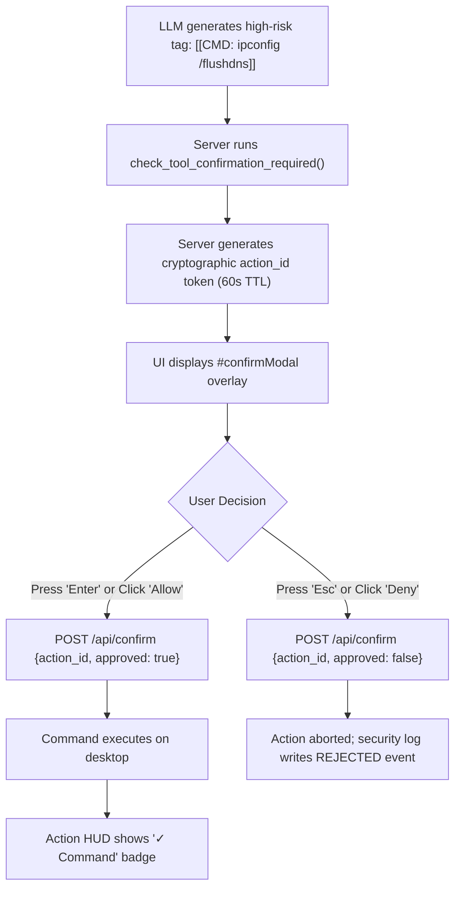

# Nova AI — Design System & UI/UX Specification

> **System Version:** Nova AI v2.5 Design System  
> **Source Files Analyzed:** `web/index.html`, `web/style.css`, `web/tailwind.js`, `web/app.js`, `web/remote.html`, `web/remote.css`, `web/remote.js`  
> **Architectural Paradigm:** Dark Sci-Fi Glassmorphism HUD + Dual Mode Theming (Developer Cyan vs. Cyber Crimson) + Mini Floating Desktop HUD.

---

## 1. Full Color Palette

Nova AI implements two distinct persona themes across desktop and mobile clients:
1. **Developer Mode (Default):** A futuristic, holographic deep-space cyan aesthetic inspired by J.A.R.V.I.S. and military HUDs.
2. **Cyber Mode (WormGPT / Red Team):** An aggressive, high-contrast crimson and pitch-black terminal aesthetic for security analysis.

### 1.1 Developer Mode Color Palette (Desktop & Mobile)

| Role Label | Token / CSS Variable | Hex / RGBA Value | Usage Location | Contrast Ratio (vs Background) |
|:---|:---|:---|:---|:---:|
| **Background Deep** | `darkbg` / `--bg` | `#02060d` | Radial gradient background perimeter, mini-mode canvas backing | Base |
| **Background Center**| — | `#06121f` | Radial gradient center highlight (`ellipse at center`) | Base |
| **Surface Glass** | `glass` | `rgba(3, 14, 24, 0.75)` | Sidebar modal panel (`#panel`), header, action HUD overlay | — |
| **Surface Card** | — | `rgba(0, 12, 24, 0.60)` | Note cards (`.note-card`), timer cards (`.timer-card`), tab rows | — |
| **Surface Input** | — | `#020a12` | Inputs, dropdown selects, textareas | — |
| **Primary Accent** | `cyan` / `--c` | `#37d6ff` | Brand title, primary button outlines, active borders, status glows | $10.5:1$ (AAA) |
| **Primary Hover** | — | `rgba(55, 214, 255, 0.25)`| Button hover background, active character highlight | — |
| **Secondary Accent**| `purple` / `--c2` | `#7a5cff` | Gradient stop for `.btn-primary` and user message bubbles | $5.2:1$ (AA) |
| **Success / Neon** | `neon` | `#4dffb0` | Active microphone badge, code tags, timer countdowns, success actions | $12.8:1$ (AAA) |
| **Warning / Standby**| — | `#ffd24d` | Thinking status text, connection warning dot, agent timer warning | $11.4:1$ (AAA) |
| **Danger / Alert** | — | `#ff5d73` | Error message toasts, connection failure dot, blocked actions | $5.8:1$ (AA) |
| **Text Bright** | — | `#ffffff` | Headings, card titles, focused input text | $18.2:1$ (AAA) |
| **Text Standard** | — | `#d8f3ff` | Body text, subtitle dialogue, mobile chat transcript | $13.6:1$ (AAA) |
| **Text Muted / Dim**| `dim` / `--dim` | `#7fa6b8` | Field labels, description hints, inactive status indicators | $5.1:1$ (AA) |
| **Text Secondary** | — | `#cfe9f5` | Skill item descriptions, note body text | $12.1:1$ (AAA) |
| **Border Subtle** | — | `rgba(55, 214, 255, 0.15)`| Card borders, row dividers, header separator | — |
| **Border Active** | — | `rgba(55, 214, 255, 0.40)`| Input focus rings, button borders, active modal outlines | — |
| **Glow Primary** | — | `rgba(55, 214, 255, 0.30)`| Hover box-shadow on `.btn` (`0 0 15px rgba(55,214,255,0.3)`) | — |
| **Glow Primary Hot**| — | `rgba(55, 214, 255, 0.40)`| Primary button shadow (`0 0 20px rgba(55,214,255,0.4)`) | — |

### 1.2 Cyber Mode Color Palette (Red Team Terminal)

Activated via `body.cyber-mode` toggle (`ModeManager.toggle()` in `web/app.js:280`):

| Role Label | CSS Variable / Rule | Hex / RGBA Value | Usage Location | Contrast Ratio (vs Background) |
|:---|:---|:---|:---|:---:|
| **Background Deep** | `body.cyber-mode` | `#050102` | Dark perimeter radial gradient (`#1b0204 0%, #050102 70%`) | Base |
| **Background Mobile**| `--bg` | `#030001` | Mobile remote background in cyber mode | Base |
| **Surface Panel** | `body.cyber-mode #panel`| `rgba(14, 1, 3, 0.96)` | Settings and skill sidebar panel | — |
| **Surface Input** | `input, textarea` | `#0d0102` | Terminal-style input backgrounds | — |
| **Primary Cyber Red**| `--c` | `#ff1a1a` / `#ff2a2a` | Brand title, active buttons, focus glow, particle core | $5.2:1$ (AA) |
| **Primary Gradient** | — | `linear-gradient(#ff1a1a, #990000)` | Primary action buttons and user chat bubbles | — |
| **Border Cyber** | — | `rgba(229, 9, 20, 0.45)`| Button borders, panel outlines, input focus rings | — |
| **Glow Cyber** | — | `rgba(255, 26, 26, 0.80)`| Text shadow on `.brand` (`0 0 16px rgba(255,26,26,0.8)`) | — |
| **Text Muted Cyber** | `#status`, `#clock` | `#d1777e` | Subtitles, status clock, mobile dim labels | $4.8:1$ (AA) |
| **Text Bright Cyber**| — | `#ffd6d6` / `#ffffff` | Body text, heading titles | $14.1:1$ (AAA) |

---

## 2. Typography

Nova AI utilizes clean, geometric sans-serif fonts for HUD readability paired with strict monospaced typefaces for code, timers, and hardware telemetry.

### 2.1 Font Families
* **Primary Sans-Serif (`font-sans`):** `system-ui, -apple-system, BlinkMacSystemFont, "Segoe UI", Roboto, "Helvetica Neue", Arial, sans-serif`
  * *Usage:* Dashboard body, headings, navigation buttons, dialogue subtitles, modal text.
* **Monospace (`font-mono`):** `ui-monospace, SFMono-Regular, Menlo, Monaco, Consolas, "Liberation Mono", "Courier New", monospace`
  * *Usage:* Terminal outputs, action HUD command previews, timer countdowns, clock, note categories, code blocks.

### 2.2 Type Scale

| Class / Style | Font Size | Line Height | Letter Spacing | Font Weight | Typical Usage |
|:---|:---:|:---:|:---:|:---:|:---|
| `text-[10px]` | $10\text{px}$ ($0.625\text{rem}$) | $14\text{px}$ | `0.1em` (`tracking-widest`) | 600 (Semibold) | Note category pills, micro-badges |
| `text-[11px]` | $11\text{px}$ ($0.6875\text{rem}$) | $16\text{px}$ | `0.05em` (`tracking-wider`) | 600 (Semibold) | Form field labels (`label`), inline code tags |
| `text-xs` | $12\text{px}$ ($0.75\text{rem}$) | $16\text{px}$ | `0.05em` (`tracking-wider`) | 600 (Semibold) | Standard buttons (`.btn`), hints, status text |
| `text-sm` | $14\text{px}$ ($0.875\text{rem}$) | $20\text{px}$ | `0.05em` (`tracking-wider`) | 600 (Semibold) | Section subheaders (`h3`), note titles, mobile body |
| `text-base` | $16\text{px}$ ($1.00\text{rem}$) | $24\text{px}$ | `0.25em` (`tracking-[0.25em]`) | 700 (Bold) | Modal headings (`h2`), mobile message text |
| `text-lg` | $18\text{px}$ ($1.125\text{rem}$) | $28\text{px}$ | `0.025em` | 700 (Bold) | Dialogue subtitle highlight |
| `text-xl` | $20\text{px}$ ($1.25\text{rem}$) | $28\text{px}$ | `0.3em` (`tracking-[0.3em]`) | 700 (Bold) | Brand logo (`NOVA AI`) |

---

## 3. Spacing, Elevation & Glassmorphism

### 3.1 Spacing Scale
* `0.5` ($2\text{px}$): Inline micro-spacing (dot margins, badge vertical padding).
* `1` ($4\text{px}$): Pill padding (`px-2 py-0.5`), tight button gaps.
* `2` ($8\text{px}$): Form field gaps, list item padding, header mini-mode padding.
* `2.5` ($10\text{px}$): Sidebar vertical gap (`gap-2.5`), timer card padding.
* `3` ($12\text{px}$): Standard card gutters, browser bar padding.
* `3.5` ($14\text{px}$): Note card padding (`p-3.5`), header standard padding.
* `4` ($16\text{px}$): Button horizontal padding (`px-4`), mobile screen padding.
* `6` ($24\text{px}$): Primary button horizontal padding (`px-6`), desktop side margins.

### 3.2 Border Radius
* `rounded-sm` ($2\text{px}$): Inline code tags.
* `rounded` ($4\text{px}$): Default inputs, buttons (`.btn`), cards (`.note-card`), select elements.
* `rounded-lg` ($8\text{px}$): Floating dialogue subtitles, action HUD container, modal dialogues.
* `rounded-full` ($9999\text{px}$): Microphone button, mobile pill chips, mobile send button, connection status indicators.

### 3.3 Glassmorphism & Elevation
Nova AI utilizes layered backdrop filtration over dynamic particle canvases:
* **Modal Glass (`#panel`):** `background: rgba(3, 14, 24, 0.75); backdrop-filter: blur(16px); border: 1px solid rgba(55, 214, 255, 0.35); box-shadow: 0 0 45px rgba(0, 0, 0, 0.85);`
* **Card Surface Glass (`.note-card`):** `background: rgba(0, 12, 24, 0.60); backdrop-filter: blur(4px); border: 1px solid rgba(55, 214, 255, 0.20);`
* **Floating Dialogue Subtitle (`#subtitle`):** `background: rgba(2, 8, 16, 0.80); backdrop-filter: blur(8px); border: 1px solid rgba(55, 214, 255, 0.30);`
* **Mini HUD Header:** `background: rgba(0, 10, 20, 0.90); backdrop-filter: blur(12px); border-bottom: 1px solid rgba(55, 214, 255, 0.20);`

### 3.4 Keyframe Animations & Transitions

```css
@keyframes hudIn {
  0% { opacity: 0; transform: translateY(8px); }
  100% { opacity: 1; transform: translateY(0); }
}

@keyframes toastIn {
  0% { opacity: 0; transform: translateX(30px); }
  100% { opacity: 1; transform: translateX(0); }
}

@keyframes agentPulse {
  0%, 100% { opacity: 1; transform: scale(1); }
  50% { opacity: 0.35; transform: scale(1.5); }
}

@keyframes micPulse {
  50% { box-shadow: 0 0 0 8px rgba(77, 255, 176, 0.2); }
}
```
* **Global Transition Duration:** `300ms ease` applied to `#nodes`, `#world`, `#agentBadge`, `#subtitle`, and `#textform input` for smooth collapse/expand during Cyber Mode and Mini HUD transitions.

---

## 4. Layout Architecture & Modes

```text
+-----------------------------------------------------------------------------------+
| HEADER: [NOVA AI]   [STATUS]   [AGENT ACTIVITY]   [LANG] [CYBER] [MINI]   [CLOCK]  |
+-----------------------------------------------------------------------------------+
|                                                                                   |
|  [NAV PILLS]                      [3D PARTICLE CORE]               [WORLD PANEL]  |
|  - Nova Browser                                                     - Rotating    |
|  - Second Brain                      (HTML5 Canvas)                   Globe       |
|  - Schedule                                                         - BBC News    |
|  - Automations                                                        Headlines   |
|  - Skills                                                                         |
|  - Workspace                                                                      |
|  - Settings                                                                       |
|                                                                                   |
|                               [ACTION EXECUTION HUD]                              |
|                          ✓ Created file: workspace/app.py                         |
|                                                                                   |
|                             [SUBTITLE DIALOGUE TEXT]                              |
|                       "I have written the application..."                         |
|                                                                                   |
+-----------------------------------------------------------------------------------+
| FOOTER: [START AI]   [MIC ON]   [EYE SCREEN]   [==== Input prompt ====]   [SEND]  |
+-----------------------------------------------------------------------------------+
```

### 4.1 Layout Components
1. **Top Header Bar (`header`):** Fixed to top ($h \approx 52\text{px}$). Contains brand logo with cyan text glow, status indicator, agent activity pill with pulsing radar dot, quick language dropdown, Cyber Mode toggle button, Mini HUD toggle button, and live clock.
2. **Left Navigation Bar (`#nodes`):** Fixed to left vertical center (`top-1/2 -translate-y-1/2`). Vertical stack of semi-transparent glass buttons opening slide-out panels.
3. **Right World Monitor (`#world`):** Fixed to right vertical center. Contains 3D wireframe rotating globe canvas ($220\times 220\text{px}$) and BBC world headlines ticker.
4. **Central 3D Particle Canvas (`#core`):** Full-screen background canvas rendering 1100 particles rotating in spherical coordinates. Rotational velocity and amplitude dynamically scale with voice input and audio playback levels.
5. **Floating Action HUD (`#actionHud`):** Positioned at bottom $120\text{px}$. Emits real-time badges indicating tool execution status (e.g. `✓ Opened VS Code`, `✓ Created file: app.py`, `⚠ Command timed out`).
6. **Floating Subtitle Dialogue (`#subtitle`):** Docked at bottom $75\text{px}$. Width dynamically adapts to content (up to $980\text{px}$). Displays conversational turn text with typewriter rendering.
7. **Bottom Input Dock (`footer`):** Docked at bottom $16\text{px}$. Holds AI activation button, microphone mute toggle, screen vision button, command input form, and send button.

### 4.2 Mini Floating HUD Mode
Activated via `#btnMiniMode` (`web/app.js:295`):
* Adds `body.mini-mode`.
* Hides `#nodes` sidebar, `#world` news/globe, `#actionHud`, brand logo, language picker, and clock.
* Resizes input field to $140\text{px}$.
* Docks subtitle tightly to bottom $56\text{px}$ with compact $13\text{px}$ font.
* Designed to remain pinned in the corner of a screen over games, IDEs, or movies.

### 4.3 Responsive Breakpoints
* **Desktop ($>1024\text{px}$):** Full three-column layout (left sidebar, center canvas, right globe).
* **Tablet / Small Screen (`max-lg` $<1024\text{px}$):** `#nodes` shifts from vertical left sidebar to horizontal bottom toolbar (`bottom-[150px] flex-row flex-wrap justify-center`). `#world` globe collapses to avoid viewport clutter.

---

## 5. Component Inventory

### 5.1 Buttons

| Component | Selector / Classes | Normal State | Hover State | Active / Focus State |
|:---|:---|:---|:---|:---|
| **Standard Action**| `.btn` | `bg-[#37d6ff]/10 border border-[#37d6ff]/40 text-[#37d6ff]` | `bg-[#37d6ff]/25 shadow-[0_0_15px_rgba(55,214,255,0.3)]` | `scale-[0.98]` |
| **Primary Action** | `.btn-primary` | `bg-gradient-to-r from-[#37d6ff] to-[#7a5cff] text-[#00131c] font-bold` | `brightness-110 shadow-[0_0_20px_rgba(55,214,255,0.5)]` | `scale-[0.98]` |
| **Start AI Toggle**| `#start` | `border-[#37d6ff]/40 text-[#37d6ff]` | `bg-[#37d6ff]/20` | When active: `.btn-primary` glowing state |
| **Mic On / Mute** | `#mute` | `.btn` state | `.btn` hover state | When muted: `border-red-500/50 text-red-400` |
| **Cyber Mode** | `#btnModeToggle` | Outlined pill button | Mode-dependent neon glow | In Cyber: red neon outline |
| **Modal Close** | `#close` | `text-[#37d6ff] text-2xl font-bold` | `text-white scale-110` | — |

### 5.2 Form Inputs

| Component | Selector | Styling & Tokens | States (Hover, Focus, Disabled) |
|:---|:---|:---|:---|
| **Text Input** | `input[type="text"]`| `bg-[#020a12] border border-[#37d6ff]/30 text-white rounded p-2 text-xs` | Focus: `border-[#37d6ff] shadow-[0_0_10px_rgba(55,214,255,0.3)]` |
| **Dropdown Select**| `select` | `bg-[#020a12] border border-[#37d6ff]/30 text-white rounded p-2 text-xs` | Focus: `border-[#37d6ff]` |
| **Text Area** | `textarea` | `bg-[#020a12] border border-[#37d6ff]/30 text-white rounded p-2 text-xs font-mono` | Focus: `border-[#37d6ff]` |
| **Chat Dock Input**| `#text` | `bg-black/60 border border-[#37d6ff]/30 text-white rounded-full px-4 py-2` | Focus: `border-[#37d6ff] shadow-[0_0_12px_rgba(55,214,255,0.4)]` |

### 5.3 Cards & Data Display

| Component | Class Name | Internal Structure | Visual Style |
|:---|:---|:---|:---|
| **Second Brain Note**| `.note-card` | `.note-header`, `.note-title`, `.note-cat`, `.note-body` | Glass container with $4\text{px}$ blur, category badge with cyan pill |
| **Timer / Reminder** | `.timer-card` | Label text + `.timer-time` font-mono countdown | Dark glass card with neon green font-mono countdown |
| **Browser Tab Row** | `.browser-tab-row`| Tab favicon/title + tab ID + close/activate buttons | Bordered row with subtle hover illumination |
| **Skill Category** | `.skill-cat` | `h3` title with icon + `.skill-item` list | Subtle cyan glass container with divider lines |

### 5.4 Modals & Overlays

| Modal Identifier | DOM Selector | Trigger Event | Visual Presentation & Dismissal |
|:---|:---|:---|:---|
| **Sidebar Panels** | `#panel` | Click on any `#nodes button[data-panel]` | Slide-out glass drawer ($w \approx 480\text{px}$, $h=100\%$) on left edge. Dismiss: `#close` or outside click. |
| **Security Confirmation** | `#confirmModal` | High-risk tool tag emitted by LLM | Centered floating modal overlay with prompt and command preview box. Dismiss: Allow (`Enter`) or Deny (`Esc`). |
| **Spotlight Command Palette**| `#spotlightModal` | `Ctrl+Space` or `Win+K` | Centered top-third floating search input with live suggestion pills. Dismiss: `Esc` or click backdrop. |
| **Agent Activity Inspector** | `#agentDetail` | Click on `#agentBadge` in header | Centered diagnostics dialogue showing step-by-step agent thoughts and execution timer. |

---

## 6. Icons & Visual Assets

### 6.1 Graphical Canvases
* **3D Particle Core (`canvas#core`):** Mathematical point cloud rendering 1100 points via perspective projection. Reacts dynamically to volume levels and speech recognition states.
* **Wireframe Rotating Globe (`canvas#globe`):** $220\times 220\text{px}$ HTML5 Canvas rendering orthographic wireframe planet with latitude ellipses and rotating longitude circles.

### 6.2 Unicode & Emoji Iconography

| Symbol | Glyph | Purpose / Usage |
|:---|:---:|:---|
| **Vision Camera** | 👁️ | `#btnVision` Screen vision capture button |
| **Mini HUD** | 🗖 | `#btnMiniMode` Window shrink toggle |
| **Status Active** | ● | Browser connected, timer running |
| **Status Inactive**| ○ | Browser stopped, service offline |
| **Execution Success**| ✓ | Action HUD positive badge |
| **Execution Failure**| ⚠ | Action HUD failure badge |
| **Close** | × | Modal dismiss button (`#close`) |
| **Microphone Active**| 🎤 | Audio listening indicator |

---

## 7. UX Interaction Flows

### 7.1 First-Time Onboarding & Setup Flow


### 7.2 Voice Interaction & Barge-In Flow


### 7.3 High-Risk Security Confirmation Flow


---

## 8. Design Inconsistencies & Accessibility Audit

### 8.1 Accessibility & Usability Findings

1. **Color Contrast in Cyber Mode (Borderline AA):**
   * *Location:* `web/style.css` (`body.cyber-mode #status`, `body.cyber-mode #clock`).
   * *Issue:* The muted red text `#d1777e` over `#050102` has a contrast ratio of $4.8:1$. While passing WCAG AA for normal text ($4.5:1$), it can be difficult to read in bright desktop environments.
   * *Recommendation:* Brighten muted cyber text to `#e58e95` (achieves $6.2:1$).
2. **Missing Keyboard Focus Indicators on Navigation Buttons:**
   * *Location:* `web/index.html` (`#nodes button`).
   * *Issue:* Navigation pills rely on `hover:` background changes but lack explicit `:focus-visible` outline rings for users tabbing through controls via keyboard.
   * *Recommendation:* Add `focus-visible:ring-2 focus-visible:ring-[#37d6ff] focus-visible:outline-none` to `.btn`.
3. **Screen Reader Deficits on Canvas Elements:**
   * *Location:* `web/index.html` (`<canvas id="core">`, `<canvas id="globe">`).
   * *Issue:* Visual canvases lack `role="img"` and `aria-label` attributes, rendering them invisible or confusing to assistive screen readers.
   * *Recommendation:* Add `aria-hidden="true"` to `#core` and `#globe` since they represent decorative animated elements.
4. **Mobile Remote Font Sizing on High-DPI Screens:**
   * *Location:* `web/remote.css` (`.brand`, `.mode-btn`).
   * *Issue:* Some UI labels use fixed small pixel sizes ($11\text{px}$) which appear overly small on high-density mobile displays.
   * *Recommendation:* Use relative `rem` or dynamic viewport units (`clamp(0.75rem, 2.5vw, 0.875rem)`).
