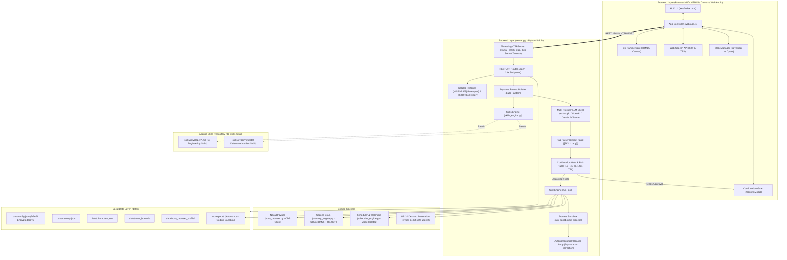

# Nova AI: Master Architectural Blueprint & System Specification
*Optimized for Claude AI and LLM Cognitive Ingestion — 36 Agentic Skills & 104 Passing Tests*

---

## 1. Executive Summary

**Nova AI Assist** is a voice-first, multimodal desktop AI assistant, full PC controller, and autonomous coding agent designed to run locally on a user's machine (`http://127.0.0.1:8765`).

### Foundational Principles:
1. **Zero External PIP Dependencies**: The entire backend operates exclusively on the **Python 3.8+ Standard Library** (`socket`, `http.server`, `urllib`, `sqlite3`, `ctypes`, `threading`, `json`, `re`, `subprocess`, `hashlib`, `pathlib`, `shlex`, `secrets`, `hmac`, `math`, `unicodedata`, etc.). Zero third-party pip packages are required to boot or execute all skills.
2. **2-in-1 Dual Personality & Switchable Operating Modes**:
   - **Developer Mode**: Classic cyan/dim sci-fi aesthetic inspired by JARVIS. Full desktop control, autonomous code writing, self-healing execution loop, second brain note retrieval, DOM browser automation, and PC telemetry.
   - **Cyber Mode**: Red WormGPT-style hacker-terminal theme (`#ff1a1a` / `#e50914`). Hides auxiliary sidebars and expands chat area. Employs a dedicated InfoSec system prompt (**Nova Cyber**) and isolated conversation memory buffer for vulnerability analysis, secure coding, CTF challenges, threat modeling, and defensive tool development. Restricts execution strictly to 13 defensive/technical tools.
3. **Agentic Coding Skills Subsystem**: 36 reusable Markdown procedures (`skills/developer/*.md` and `skills/cyber/*.md`) dynamically parsed, ranked, and injected into the LLM system prompt by `skills_engine.py` per turn.
4. **Hardware & OS Deep Integration**: Native Win32 desktop automation via 64-bit safe `ctypes` (mouse clicks, cursor movement, hotkeys, keystroke typing, active foreground window inspection) and autonomous Chrome DevTools Protocol (CDP) WebSocket browser automation.
5. **Multi-Model Provider Agnostic**: Native standard-library HTTP clients for Anthropic (Claude), OpenAI, Google Gemini, Groq, OpenRouter, and local LLMs (Ollama / LM Studio) without third-party vendor SDKs.
6. **Multi-Layered Security Architecture**: Strict process sandbox with environment sanitization, per-subcommand git allowlisting, Windows reserved device name validation, sensitive files blocking, Windows DPAPI key encryption, cross-site fetch site/referer verification, 32-byte pairing tokens with brute-force lockout, and an interactive confirmation gate for high-impact tools.

---

## 2. High-Level System Architecture



---

## 3. Project Directory & File Manifest

```
d:\Developer Mode on\nova-ai\
├── server.py                        # Core server: HTTP server, API endpoints, LLM router, skills execution, process sandbox, confirmation gate
├── skills_engine.py                 # Agentic skills engine: dynamic frontmatter parsing, Devanagari/multilingual ranking, prompt injection
├── memory_engine.py                 # Second Brain: SQLite semantic storage + pure Python BM25 ranking with Robertson-Spärck Jones IDF
├── nova_browser.py                  # Headless/visible CDP browser controller (pure Python WebSocket CDP client)
├── scheduler_engine.py              # Background job scheduler, recurring cron tasks, battery/RAM hardware watchdog (mode-isolated)
├── run.bat / run.sh                 # Single-click launcher (starts server.py and opens browser)
├── data/                            # Persistent runtime data
│   ├── config.json                  # Active settings, DPAPI-encrypted API keys, voice params, max_tokens, app shortcuts
│   ├── characters.json              # System prompts for assistant personas (Jarvis, Nova, Cyber, etc.)
│   ├── memory.json                  # Permanent memory facts injected into system prompt
│   └── nova_brain.db                # SQLite database for Second Brain notes, tags, full-text storage
├── skills/                          # Reusable engineering & cybersecurity procedures
│   ├── developer/*.md               # 18 Developer Mode Skills
│   └── cyber/*.md                   # 18 Cyber Mode Skills (with defensive guardrails)
├── web/                             # Web interface (zero npm / zero build tools)
│   ├── index.html                   # HUD layout, canvas core, sidebar panels, scrollable #confirmModal
│   ├── app.js                       # Client controller: speech recognition, particle canvas, UI rendering, confirmation handling
│   ├── remote.html / remote.js      # Mobile companion interface for smartphone on same Wi-Fi
│   └── qr.js                        # Lightweight pure JS QR generator for instant mobile pairing
├── test_*.py                        # Complete test suite in repo root (104 passing unit tests, zero pip dependencies)
│   ├── test_phase1_security.py      # DPAPI encryption, sensitive files protection, unified tag execution, RUN_CODE confirmation
│   ├── test_phase2_reliability.py   # Git flag allowlist, confirmation binding rules (a-e), tool classification, taint tracking, /api/config token gate
│   ├── test_phase3_medium_low.py    # SAFE_STATE_FIELDS allowlist, prompt-allowlist sync, automation taint, markdown code fences, smart-home redirects, request body cap (10MB HTTP 413), JSON depth, CDP flags, preview truncation, telemetry masking, Windows device names, Cyber mode restrictions
│   ├── test_phase3_search.py        # Devanagari Unicode tokenization, BM25 Robertson-Spärck Jones IDF ranking
│   ├── test_phase4_integration.py   # Stdlib dependencies verification, screenshot workspace path, ORGANIZE confirmation gate
│   ├── test_config_max_tokens.py    # Real HTTP endpoint validation for max_tokens configuration and fallback
│   ├── test_os_automation.py        # Isolated OS mouse/keyboard automation tests (ctypes.windll.user32 mocked)
│   ├── test_skills.py               # Skills parsing, frontmatter validation, relevance scoring
│   ├── test_mode_switch.py          # Developer vs Cyber state isolation and switching
│   ├── test_memory_engine.py        # SQLite second brain, BM25 search, memory facts
│   ├── test_scheduler.py            # Timers, recurring automations, and watchdog
│   ├── test_workspace_boundary.py   # Path traversal and workspace boundary verification
│   ├── test_smart_home.py           # Webhook dispatch and local network calls
│   ├── test_agent_healing.py        # Autonomous 2-pass error correction loop
│   ├── test_nova_browser.py         # CDP protocol and tab management
│   └── test_nova_browser_interactive.py # Click, type, scroll, and tab switching
```

---

## 4. Security Architecture & Process Sandboxing

### 4.1. Confirmation Gate & Risk Table
Destructive, external, or high-impact actions are intercepted before execution:
- **`ALWAYS_CONFIRM`**: `RUN_CODE`, `CMD`, `POWERSHELL`, `SYSTEM` (shutdown, restart, sleep, lock, empty recycle bin), `GIT` (`push`, `pull`, `clone`, `remote`), `ORGANIZE` (file sorting/moving), `DELETE_NOTE`, `FORGET`, `SCHEDULE_AUTO`, `AUTOMATE`, `CLOSE_APP`, `BROWSER_WHATSAPP`, `BROWSER_TELEGRAM`, and `SMART_HOME` modifying methods (`POST`, `PUT`, `DELETE`, `PATCH`).
- **`CONFIRM_IF_TAINTED`**: `WRITE_FILE`, `EDIT_FILE`, `CREATE_PROJECT`, `TYPE_KEYS`, `HOTKEY`, `MOUSE_CLICK`, `GIT` when invoked in a tainted turn (after reading untrusted input like `BROWSER_RESEARCH`, `BROWSER_OPEN`, `VISION`, `READ_FILE`, `BRIEFING`, or any mobile source turn).
- **`NO_CONFIRM`**: Safe read-only inspection (`NOTE`, `SEARCH_NOTES`, `REMIND`, `TIMER`, `VOLUME`, `MEDIA`, `PLAY`, `SCREENSHOT`, `ACTIVE_WINDOW`, `BRIEFING`, `LIST_AUTOMATIONS`, `CANCEL_AUTOMATION`, `BROWSER_CLOSE`, `BROWSER_RESEARCH`) on untainted desktop requests.
- **Deny-by-Default Fallback**: Any tool not explicitly classified requires user confirmation by default.
- **Confirmation Binding Rules (a–e)**:
  - (a) Last assistant message in mode history must be the confirmation prompt.
  - (b) Pending action source must match chat source (desktop chat cannot approve phone actions).
  - (c) Confirmation must arrive within 60 seconds of prompt creation.
  - (d) Approval message must be concise (<= 3 words, e.g. "yes", "proceed").
  - (e) Approval is rejected if multiple pending actions exist in that mode.
  - Tainted turns or mobile actions strictly require the desktop HUD "Allow" button.
- **Preview & Action IDs**:
  - Action IDs are generated via `secrets.token_hex(8)` (16 hex chars).
  - Previews show full commands up to 20,000 characters, with explicit `... [truncated, N more characters]` marker.

### 4.2. Process Sandboxing (`RUN_CODE`, `CMD`, `POWERSHELL`)
- Working directory (`cwd`) is strictly resolved within `WORKSPACE` via `resolve_workspace_path()`.
- **Environment Sanitization**: Child process environment is scrubbed. All variables containing `KEY`, `TOKEN`, `SECRET`, `PASSWORD`, `CREDENTIAL`, or `AUTH` are completely removed. `HOME` and `USERPROFILE` are directed to the isolated workspace folder.
- **Trusted Window**: Configurable `run_code_trusted_minutes` (default 0 = off) allows untainted desktop code runs to auto-approve for N minutes after an initial confirmation. Tainted turns never auto-approve.
- **Process-Tree Termination**: Commands enforce a hard timeout (1–300s, default 60s). On timeout, the entire process tree is terminated cleanly (`taskkill /F /T /PID` on Windows, `proc.kill()` on Unix).
- **Output Capping**: `stdout` and `stderr` are hard-capped at 100 KB to prevent buffer-exhaustion DOS attacks.
- **Pattern Blacklisting**: Obvious destructive patterns (`format`, `del /s [drive]:\`, `rd /s /q [drive]:\`, `rm -rf /`, `shutdown /r`, `reg delete HKLM`) are unconditionally blocked.

### 4.3. Git Hardening
- Executed with `shell=False` via parsed token lists (`shlex.split`).
- Subcommands strictly restricted to allowlist: `status`, `diff`, `log`, `add`, `commit`, `branch`, `checkout`, `switch`, `init`, `show`, `stash`, `restore`, `pull`, `push`, `clone`, `remote` (read-only), `fetch`.
- Per-subcommand flag allowlist enforced via `GIT_SUBCOMMAND_FLAGS`.
- Unconditional rejection of dangerous argument injection flags: `--output`, `-o`, `--upload-pack`, `--receive-pack`, `--exec`, `--no-index`, `--ext-diff`, `--paginate`, `-C`, `--exec-path`, `--git-dir`, `--work-tree`, and `-c` (except `-c` in `git switch`).
- Remote/clone URL validation: Only `https://`, `http://`, `ssh://`, or `git@` schemes allowed. `file://`, `ext::`, and unknown schemes are rejected.
- Safe configurations enforced on every call: `-c core.hooksPath=`, `-c core.fsmonitor=false`, `-c protocol.ext.allow=never` with global/system config redirected to `NUL` / `/dev/null`.

### 4.4. Sensitive Files Protection & Windows DPAPI
- Sensitive configuration and database files (`data/config.json`, `data/nova_brain.db`, `data/nova_browser_profile/`, and any `.env` or `config.json` inside the installation folder) are denied from `READ_FILE`, `WRITE_FILE`, `EDIT_FILE`, and `LIST_FILES`.
- API keys in `data/config.json` are encrypted at rest using Windows Data Protection API (**DPAPI**) via `ctypes.windll.crypt32.CryptProtectData`. Threat model boundary: DPAPI protects keys across users and offline disk inspection on the same machine, NOT against malware executing as the current user. On non-Windows platforms, keys fall back to basic obfuscation with a warning.

### 4.5. Windows Reserved Device Names
- All workspace operations reject Windows reserved device names: `CON`, `PRN`, `AUX`, `NUL`, `COM1`–`COM9`, `LPT1`–`LPT9` (with or without extensions, any casing, trailing dots or spaces) with a clear `Reserved Windows device name` error.

### 4.6. Telemetry Masking
- All API keys, tokens (`Bearer ...`, `api_key=...`, `token=...`, `sk-...`, long hex/base64 strings, and config secrets) are automatically masked before persisting into `act_step`, `act_phase`, `act_end`, `add_event`, `/api/activity`, and `/api/events`.

### 4.7. Cyber Mode Tool Restrictions
- In Cyber Mode (`mode="cyber"`), tool execution is strictly restricted to 13 technical and defensive tools: `NOTE`, `SEARCH_NOTES`, `READ_FILE`, `LIST_FILES`, `WRITE_FILE`, `EDIT_FILE`, `RUN_CODE`, `BROWSER_RESEARCH`, `BROWSER_OPEN`, `TIMER`, `REMIND`, `BRIEFING`, `VISION`.
- Leisure and auxiliary tools (`PLAY`, `VOLUME`, `BROWSER_YOUTUBE`, `SMART_HOME`, etc.) return `"Not available in Cyber Mode"`.

### 4.8. Network & Server Hardening
- **Request Limits**: Request bodies are capped at 10 MB in `BaseHandler._body()`; requests exceeding 10 MB receive HTTP 413 Payload Too Large. JSON parsing caps recursion depth at 50 levels (HTTP 400). Socket timeout is set to 30 seconds on accepted client connections.
- **CDP Flags**: Nova Browser launches with `--remote-debugging-address=127.0.0.1` and exact `--remote-allow-origins=http://127.0.0.1:9222`.
- **Cross-Site Protection (`_local_only()`)**: Rejects non-local `Host`, rejects requests with `Sec-Fetch-Site: cross-site`, and validates `Origin`/`Referer` hostnames.
- **LLM Read Timeout & Retry Policy**: Configurable via `"llm_timeout"` (default 60s, capped at 90s in server and settings). When reasoning parameters are sent and an API error 400 or timeout occurs, the client retries at most once without reasoning parameters. The retry timeout is dynamically bounded (`max(5, min(38, 99 - initial_timeout))`) so the cumulative wait across both attempts never exceeds 100 seconds.
- **Mobile Remote (Port 8766)**:
  - Cryptographically secure 32-byte tokens (`secrets.token_urlsafe(32)`) compared using `hmac.compare_digest`.
  - Brute-force lockout: 5 failed attempts locks out the client IP for 15 minutes (900s).

---

## 5. Second Brain & Language Processing

### 5.1. BM25 with Robertson-Spärck Jones IDF
Notes semantic search uses pure Python Okapi BM25 with true Robertson-Spärck Jones IDF:
$$\text{IDF}(q) = \ln\left(1 + \frac{N - n(q) + 0.5}{n(q) + 0.5}\right)$$
$$\text{Score}(D, Q) = \sum_{q \in Q} \text{IDF}(q) \cdot \frac{f(q, D) \cdot (k_1 + 1)}{f(q, D) + k_1 \cdot \left(1 - b + b \cdot \frac{|D|}{\text{avgdl}}\right)}$$
Parameters: $k_1 = 1.5$, $b = 0.75$. Title matches receive a $3\times$ boost. Rare terms correctly rank above common terms.

### 5.2. Multilingual Tokenization
Tokenizer supports global scripts without third-party NLP libraries:
- ASCII / Latin alphanumeric (`a-zA-Z0-9_`)
- Devanagari (`\u0900-\u097F`) for Hindi, Sanskrit, Marathi, Nepali
- Bengali / Assamese (`\u0980-\u09FF`)
- Arabic / Persian / Urdu (`\u0600-\u06FF`)
- CJK Unified Ideographs (`\u4E00-\u9FFF`) for Chinese, Japanese, Korean

---

## 6. Complete API Specification (36 Local Routes + 3 Remote Routes)

### 6.1. Local API (`http://127.0.0.1:8765`)

#### GET Endpoints (11):
| Route | Parameters | Response | Description |
| :--- | :--- | :--- | :--- |
| `GET /api/state` | None | `{"config", "characters", "memory", "presets", "os", "workspace"}` | Active state strictly via `SAFE_STATE_FIELDS` allowlist; all secrets excluded; `<secret>_set` flags |
| `GET /api/news` | None | `[{"title", "link"}]` | RSS world news headlines |
| `GET /api/remote` | None | `{"enabled", "active", "port", "urls", ...}` | Mobile pairing state |
| `GET /api/activity` | None | `{"current", "recent", "history"}` | Live task telemetry (masked) |
| `GET /api/browser/status` | None | `{"available", "running", "tabs"}` | Dedicated browser state |
| `GET /api/events` | `?after=<id>` | `{"last", "events"}` | Remote event stream for HUD (masked) |
| `GET /api/notifications` | None | `{"notifications": [...]}` | Non-clearing pending alerts |
| `GET /api/timers` | None | `{"timers": [...]}` | Active countdown timers |
| `GET /api/automations` | None | `{"automations": [...]}` | Recurring background jobs |
| `GET /api/skills` | `?mode=developer|cyber` | `{"mode", "skills": [...]}` | Mode-specific skills roster |
| `GET /api/notes` | `?q=<query>` *(optional)* | `{"notes": [...]}` | BM25 note search or listing |

#### POST Endpoints (24):
| Route | Payload | Response | Description |
| :--- | :--- | :--- | :--- |
| `POST /api/chat` | `{"message", "mode"}` | `{"reply", "actions", "pending"}` | Turn interaction & tool execution |
| `POST /api/confirm` | `{"id", "approve": bool}` | `{"ok", "approved", "result"}` | Approves or denies gated tool |
| `POST /api/notifications/clear` | None | `{"ok": true}` | Clears acknowledged notifications |
| `POST /api/config` | Partial config dict, `confirm_token` | `{"ok": true}` or `{"need_confirm": true}` | Validates and saves config |
| `POST /api/reset` | `{"mode"}` *(optional)* | `{"ok": true}` | Thread-safe history reset |
| `POST /api/memory/add` | `{"text"}` | `[...]` | Adds memory fact |
| `POST /api/memory/delete` | `{"index"}` | `[...]` | Removes memory fact |
| `POST /api/characters` | `{"characters": [...]}` | `[...]` | Updates character personas |
| `POST /api/workspace/open`| None | `{"ok": true, "path"}` | Opens workspace in OS explorer |
| `POST /api/remote/enable` | `{"enabled": bool}` | Remote state dict | Toggles mobile remote server |
| `POST /api/remote/regenerate` | None | Remote state dict | Generates new 32-byte secret token |
| `POST /api/browser/launch`| `{"url"}` *(optional)* | `{"ok", "running"}` | Launches dedicated browser |
| `POST /api/browser/open` | `{"url"}` | `{"ok", "tab_id", ...}` | Opens URL or focuses existing tab |
| `POST /api/browser/activate`| `{"tab_id"}` | `{"ok": bool}` | Switches active tab in browser |
| `POST /api/browser/close` | `{"tab_id"}` | `{"ok": bool}` | Closes specified browser tab |
| `POST /api/browser/interact`| `{"action", "value", "selector"}` | `{"result"}` | DOM click, type, or scroll |
| `POST /api/timers/add` | `{"spec", "message", "mode"}` | `{"ok": true, "id"}` | Creates new countdown timer |
| `POST /api/timers/cancel` | `{"id"}` | `{"ok": true}` | Cancels countdown timer |
| `POST /api/automations/add` | `{"spec", "action", "label", "mode"}` | `{"ok": true, "id"}` | Creates recurring task |
| `POST /api/automations/cancel` | `{"id"}` | `{"ok": true}` | Cancels recurring task |
| `POST /api/notes` (or `/save`) | `{"title", "content", "category"}` | `{"ok": true, "id"}` | Saves or updates note |
| `POST /api/notes/delete` | `{"id" | "title"}` | `{"ok": bool}` | Deletes note |
| `POST /api/vision/analyze`| `{"question"}` | `{"analysis": str}` | Analyzes desktop screenshot |
| `POST /api/exit` | None | `{"ok": true}` | Gracefully stops Nova server |

#### DELETE Endpoints (1):
| Route | Parameters / Body | Response | Description |
| :--- | :--- | :--- | :--- |
| `DELETE /api/notes` | Query `?id=` or `?title=` or JSON body | `{"ok": bool}` | Deletes note from Second Brain |

### 6.2. Mobile Remote API (`http://0.0.0.0:8766`)
- `GET /`, `GET /remote.html`, `GET /remote.js`, `GET /remote.css`: Mobile web client.
- `GET /api/remote/info`: Handshake endpoint checking token via `X-Nova-Token`.
- `POST /api/remote/chat`: Mobile chat endpoint (safe tool allowlist enforced).

---

## 7. Automated Test Suite (104 Passing Tests)

Run complete test suite from repository root:
```bash
python -m unittest discover -p "test_*.py"
```
**Status: 104 tests passing in ~18.0s (100% pass rate, zero warnings, zero external packages).**
