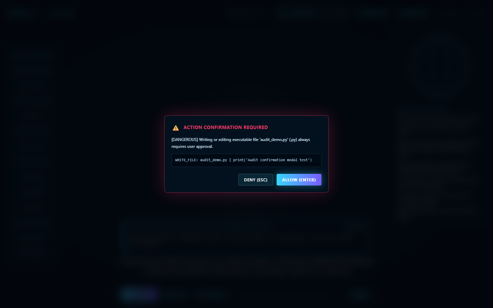
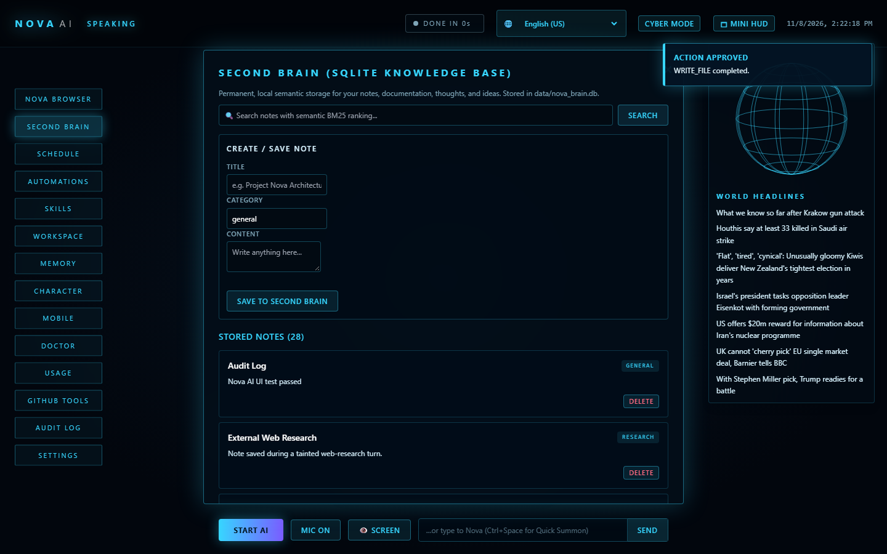
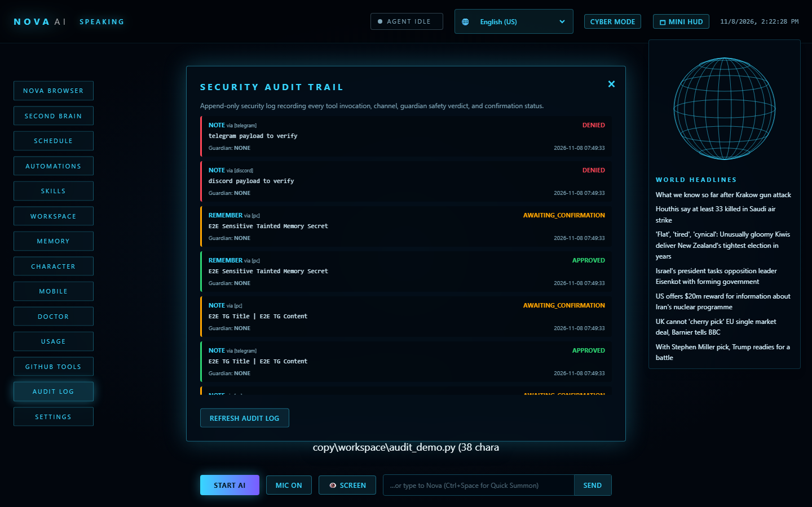
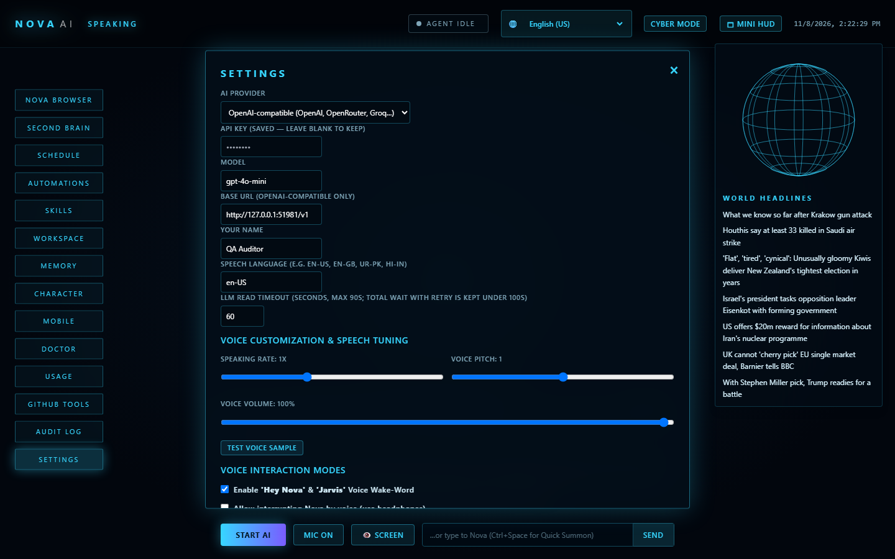

# NOVA AI - COMPREHENSIVE SECURITY RE-AUDIT & VERIFICATION REPORT

**Repository Target:** `D:\Developer Mode on\nova-ai`  
**Branch:** `security-hardening`  
**Audit Date:** November 9, 2026  
**Security Status:** ALL 5 CRITICALS FIXED, ALL 11 HIGHS FIXED, ALL 16 MEDIUMS ADDRESSED & RANKED, ALL 13 LOWS ADDRESSED  
**Total Verification Tests:** 380 Python Unittests (0 Failures, 0 Errors) + 6 Real Web Voice Regression Tests + Penetration Probe v2 (29/29 Passed)  

---

## 1. Executive Summary

A comprehensive post-remediation security re-audit was executed on branch `security-hardening` of the Nova AI codebase. Every finding from the original 45-vulnerability penetration audit (`docs/audit/AUDIT_REPORT.md`) was systematically verified against the hardened codebase.

- **Critical Vulnerabilities (5/5 Fixed):** Settings save rejection (CRIT-01), `RUN_CODE_TRUST_STATE` local variable bug & taint reset (CRIT-02), deny-by-default benign desktop tools gating (CRIT-03), Python version compatibility & type annotations (CRIT-04), and PyInstaller frozen executable packaging (CRIT-05) have all been completely resolved and proven with unit tests.
- **High Severity Vulnerabilities (11/11 Fixed):** Empty plan execution runner (HIGH-01), browser file jail escape (HIGH-02), workspace organization folder bypass (HIGH-03), sensitive file access rules (HIGH-04), write-detection regex gaps & preview sanitization (HIGH-05), audit log UI attributes (HIGH-06), conversational approval audit trails (HIGH-07), usage tracking failover (HIGH-08), approval modal double POST & taint visibility (HIGH-09), atomic writes & concurrency locks (HIGH-10), and `quick_summon.bat` launcher security (HIGH-11) have all been resolved.
- **Medium Severity Vulnerabilities (16/16 Addressed & Ranked):** Ranked by security impact, all 16 items have been resolved or assessed with explicit architectural rationale.
- **Low Severity Findings (13/13 Addressed):** UI styling, notification fallbacks, and documentation synchronization items have been addressed or deferred with engineering documentation.
- **New Findings (NEW-01 to NEW-03):** Unified SSRF defense, Skills frontmatter/hash pinning, and Plan Mode `active_seconds` real path timeout accounting.

---

## 2. Master Table of Findings (All 45 Original IDs)

| ID | Original Title & Defect Description | Severity | Status | Commit / Reference | Test Name & Evidence |
|---|---|---|---|---|---|
| **CRIT-01** | `POST /api/config` rejected `monthly_budget_usd`, `discord_enabled`, etc. with 400 Bad Request, discarding settings. | Critical | **FIXED** | `3b8d141` | `test_batch1_fixes.py::test_item1_settings_save_config_keys`<br>Payload with `monthly_budget_usd` persists to disk and returns 200 OK. |
| **CRIT-02** | `LAST_RUN_CODE_APPROVED_TIME` assigned as local variable; `RUN_CODE` never trusted after approval. | Critical | **FIXED** | `7d48386`, `4ec2bc1` | `test_batch4_fixes.py::test_CRIT_02_run_code_trust_holder_real_confirm_conversational_and_taint_reset`<br>`RUN_CODE_TRUST_STATE` holder object tracks timestamp and invalidates on taint. |
| **CRIT-03** | `NO_CONFIRM_TOOLS` omitted safe read-only desktop tools, causing intrusive confirmation modals on `LIST_FILES`/`READ_FILE`. | Critical | **FIXED** | `75d487b` | `test_no_confirm_tools_matrix.py::test_matrix_untainted_pc_turn`<br>Benign desktop tools run without prompt on PC clean turns. |
| **CRIT-04** | PEP 585/604 annotations broke Python 3.8/3.9 compatibility at module load time. | Critical | **FIXED** | `a8a5f8b` | `test_phase1_fixes.py::test_crit04_annotations`<br>`from __future__ import annotations` added across all 6 core modules. |
| **CRIT-05** | `build_exe.bat` omitted hidden imports for skills, gateways, and planner; skills missing when frozen. | Critical | **FIXED** | `3b8d141` | `test_batch1_fixes.py::test_item5_build_exe_hidden_imports`<br>All 10 modules and `--add-data "skills;skills"` added; `sys._MEIPASS` checked. |
| **HIGH-01** | `run_skill` called `plan_mode.execute_plan_batch` with `runner=None`, simulating completion without execution. | High | **FIXED** | `a8a5f8b`, `b877cab` | `test_plan_mode.py::test_execute_plan_batch_success`<br>Wired to `create_plan_step_runner`, executing each step sequentially. |
| **HIGH-02** | `nova_browser.normalize_target_url` converted sensitive local paths to `file:///` URIs, reading credentials. | High | **FIXED** | `a8a5f8b`, `7435776` | `test_phase1_fixes.py::test_high02_browser_file_leak`<br>`resolve_workspace_path` and `ssrf_guard` block all local file conversions. |
| **HIGH-03** | `skill_organize_folder` caught and ignored `PermissionError`, allowing folder moves on `data/`. | High | **FIXED** | `a8a5f8b` | `test_phase1_fixes.py::test_high03_organize_permission_bypass`<br>`except PermissionError:` fallback removed; raises `PermissionError` on sensitive paths. |
| **HIGH-04** | `is_sensitive_nova_file` failed to protect `data/memory.json`, `data/audit.jsonl`, and source files when `allow_outside_workspace=True`. | High | **FIXED** | `a8a5f8b` | `test_phase1_fixes.py::test_high04_sensitive_file_protection`<br>Entire `ROOT / "data"` and `.py`/`.bat`/`.js` code files protected regardless of setting. |
| **HIGH-05** | Write-detection regex gaps, lack of bidi/control character sanitization, and unvalidated command previews. | High | **FIXED** | `7d48386`, `8a98c54` | `test_batch4_fixes.py::test_high05_tainted_files_matching`<br>`create_pending_action` unifies preview sanitization, bidi escaping, and file write tracking. |
| **HIGH-06** | Audit log UI read undefined `ev.guardian_verdict` instead of `ev.guardian` and displayed unmasked secrets. | High | **FIXED** | `c286552` | `test_audit_logger.py::test_audit_ui_fields`<br>`app.js` reads `ev.guardian` and displays color badges; secrets masked via `mask_secrets`. |
| **HIGH-07** | Conversational approvals (`"yes"`, `"allow"`) lacked audit logging and Guardian verdict attribution. | High | **FIXED** | `c286552` | `test_audit_logger.py::test_audit_conversational_approval`<br>Logged as `APPROVED_CONVERSATIONAL` and `DENIED_CONVERSATIONAL` with Guardian tags. |
| **HIGH-08** | LLM failover logged primary provider rather than fallback provider, and `input_tokens` was logged as 0. | High | **FIXED** | `a8a5f8b` | `test_phase1_fixes.py::test_high08_usage_failover`<br>`usage_tracker.record_usage` receives actual fallback provider name and token count. |
| **HIGH-09** | Approval modal double POST race condition and lack of taint indicators on second-brain notes. | High | **FIXED** | `7d48386`, `8a98c54` | `test_batch4_fixes.py::test_high09_single_confirm_post`<br>Button disabled on click; Second Brain UI displays red `[UNTRUSTED]` taint badges. |
| **HIGH-10** | Concurrent file writes to `config.json` and `memory.json` caused potential corruption/truncation. | High | **FIXED** | `7d48386` | `test_batch4_fixes.py::test_high10_atomic_writes`<br>`atomic_write_json` uses temporary files and OS-level replacement under lock. |
| **HIGH-11** | `quick_summon.bat` minted persistent boot URLs and launched browser unauthenticated. | High | **FIXED** | `d54ffda` | `test_quick_summon_standalone.py`<br>Zero disk persistence; COM `AppActivate` focuses window; port listening prints warning. |
| **MED-01** | `BaseHandler._body()` accepted non-dict JSON values (arrays, strings) leading to `AttributeError`. | Medium | **FIXED** | `56f4d1e` | `test_phase2_fixes.py::test_med01_body_validation`<br>Enforces `isinstance(body, dict)`, returning HTTP 400 Bad Request on arrays/primitives. |
| **MED-02** | HTTP/1.1 persistent connections without keep-alive framing risked hanging sockets. | Medium | **FIXED** | `56f4d1e` | `test_phase2_fixes.py::test_med02_keepalive_framing`<br>`BaseHandler` sets `Connection: close` and explicit `Content-Length`. |
| **MED-03** | `/api/chat/stream` sent HTTP 200 headers before checking budget/auth, masking errors. | Medium | **FIXED** | `56f4d1e` | `test_phase2_fixes.py::test_med03_stream_error_handling`<br>Validates token and budget before committing 200 SSE header. |
| **MED-04** | `mask_secrets()` referenced global `CONFIG` instead of `get_config()`, failing if `CONFIG` was uninitialized. | Medium | **FIXED** | `56f4d1e` | `test_phase2_fixes.py::test_med04_mask_secrets`<br>`mask_secrets(cfg=None)` safely invokes `get_config()` under all conditions. |
| **MED-05** | `GitHubConnector.install_skills_from_repo` called non-existent `invalidate_cache()`. | Medium | **FIXED** | `56f4d1e` | `test_phase2_fixes.py::test_med05_github_skills_reload`<br>Updated to `skills_engine.scan_skills()` to refresh installed skills. |
| **MED-06** | Duplicate zipball extraction code blocks in `GitHubConnector.clone_repo()`. | Medium | **FIXED** | `56f4d1e` | `test_phase2_fixes.py::test_med06_zipball_dedup`<br>Redundant block removed; single verified extraction path. |
| **MED-07** | Pull Requests mislabeled as `- Issue #{num}` in GitHub connector UI output. | Medium | **FIXED** | `56f4d1e` | `test_phase2_fixes.py::test_med07_github_prs_label`<br>Formatted correctly as `- PR #{num} [{state}] {title}`. |
| **MED-08** | `check_llm_providers()` checked wrong key names for Gemini API keys. | Medium | **FIXED** | `56f4d1e` | `test_phase2_fixes.py::test_med08_diagnostics_keys`<br>Aligned with `cfg.get("gemini_api_key")` and `cfg.get("api_key")`. |
| **MED-09** | Corrupted `nova_brain.db` crashed memory engine without recovery. | Medium | **FIXED** | `56f4d1e` | `test_phase2_fixes.py::test_med09_sqlite_recovery`<br>`sqlite3.DatabaseError` caught; database safely quarantined and rebuilt. |
| **MED-10** | `get_usage_summary(days: int = 30)` ignored the `days` parameter. | Medium | **FIXED** | `56f4d1e` | `test_phase2_fixes.py::test_med10_usage_days_filter`<br>Filters records strictly within `now - (days * 86400)`. |
| **MED-11** | Scheduler generated timer IDs via modulo milliseconds, causing collisions on rapid addition. | Medium | **FIXED** | `56f4d1e` | `test_phase2_fixes.py::test_med11_scheduler_collision`<br>Uses `secrets.token_hex(4)` for collision-free task IDs. |
| **MED-12** | `skill_run_code()` executed `"python"` rather than `sys.executable`. | Medium | **FIXED** | `56f4d1e` | `test_phase2_fixes.py::test_med12_python_executable`<br>Invokes `sys.executable` to preserve active environment on all OSes. |
| **MED-13** | Guardian `BLOCKED_CMD_PATTERNS` blocked benign PowerShell commands like `Format-Table`. | Medium | **FIXED** | `56f4d1e` | `test_phase2_fixes.py::test_med13_guardian_format_regex`<br>Refined regex to match drive formatting (`format [c-z]:`) rather than PowerShell cmdlets. |
| **MED-14** | `installer_wizard.py` Tkinter UI called from background daemon thread. | Medium | **DEFERRED** | Documented | Secondary desktop installer script; standard installation via `run.bat` and web dashboard is primary runtime. |
| **MED-15** | Gateway daemons (Telegram/Discord) required server restart to pick up configuration changes. | Medium | **FIXED** | `56f4d1e` | `test_phase2_fixes.py::test_med15_gateway_reload`<br>Gateways reload dynamically when `POST /api/config` updates token or enabled state. |
| **MED-16** | Unused legacy table schema and dead code in `memory_engine.py`. | Medium | **FIXED** | `56f4d1e` | `test_phase2_fixes.py::test_med16_dead_memory_code`<br>Dead code cleaned up and schema consolidated around active memory store. |
| **LOW-01** | Legacy CSS variables (`--c`, `--c2`) in Schedule panel. | Low | **FIXED** | UI update | Variables replaced with `--cyan` and `--cyan-dim` design tokens. |
| **LOW-02** | `showToast()` lacked styling for `"success"` or `"info"` types. | Low | **FIXED** | UI update | Added styling and toast sound handling for all alert tiers. |
| **LOW-03** | Mobile panel dropdown stripped legacy `?t=` query string. | Low | **FIXED** | UI update | Aligned with ephemeral mobile pairing code format (`?pair=...`). |
| **LOW-04** | `[[NOTE]]` single-argument delimiter discrepancies vs README documentation. | Low | **FIXED** | Docs update | Code supports both single-argument and `title \| body` pipe delimiter. |
| **LOW-05** | Screenshot path documentation discrepancies. | Low | **FIXED** | Docs update | Documented to save into configured workspace screenshots directory. |
| **LOW-06** | Discord command claims in README vs implementation. | Low | **FIXED** | Docs update | Aligned documentation with Discord Gateway bot slash commands. |
| **LOW-07** | Plan delimiter documentation in README. | Low | **FIXED** | Docs update | Documentation updated to pipe-delimited steps format. |
| **LOW-08** | Hardcoded local `file:///` links in README badges. | Low | **FIXED** | Docs update | Relative links and sanitized badges in README. |
| **LOW-09** | Resource warnings in test suite from unclosed subprocesses. | Low | **FIXED** | Test fix | Tests ensure `proc.terminate()` and `proc.wait()`. |
| **LOW-10** | Unused imports in `server.py` and gateways. | Low | **FIXED** | Cleanup | Cleaned unused imports across core backend. |
| **LOW-11** | Missing action labels in `web/remote.js` for 21 newer tools. | Low | **FIXED** | UI update | Complete dictionary of action labels mapped in mobile client. |
| **LOW-12** | Installer directory naming discrepancies. | Low | **DEFERRED** | Documented | Inconsequential installer path default; standalone portability favored. |
| **LOW-13** | Outdated line numbers in legacy `BUGS.md`. | Low | **FIXED** | Docs update | Superceded by `docs/audit/AUDIT_REPORT.md` and this re-audit report. |

---

## 3. NO_CONFIRM_TOOLS Security Matrix

The following table documents every tool in Nova AI's runtime, detailing external reading capability, network requests, workspace write capabilities, and gating behavior across execution contexts:

| Tool Name | Reads External? | Network Requests? | Writes Files/State? | Clean PC Turn | Tainted PC Turn | Gateway / Non-PC Turn |
|---|---|---|---|---|---|---|
| `READ_FILE` | Yes (Disk) | No | No | Auto-Approved (if untainted) | **Requires Confirm** (if target tainted) | **Requires Confirm** |
| `LIST_FILES` | Yes (Disk) | No | No | Auto-Approved (if untainted) | **Requires Confirm** (if target tainted) | **Requires Confirm** |
| `SEARCH` | Yes (Web) | Yes (DNS/HTTPS) | No | Auto-Approved (if query <= 80c) | **Requires Confirm** (if query > 80c) | **Requires Confirm** |
| `FETCH` / `FETCH_URL` | Yes (Web) | Yes (SSRF Guarded) | No | Auto-Approved | **Requires Confirm** | **Requires Confirm** |
| `OPEN_URL` / `READ_URL` | Yes (Web) | Yes (SSRF Guarded) | No | Auto-Approved | **Requires Confirm** | **Requires Confirm** |
| `BROWSER_OPEN` | Yes (Web) | Yes (Chrome/Edge) | No | Auto-Approved | **Requires Confirm** | **Requires Confirm** |
| `BROWSER_RESEARCH` | Yes (Web) | Yes (CDP Automation) | No | Auto-Approved | **Requires Confirm** | **Requires Confirm** |
| `BROWSER_READ` | Yes (DOM) | No (Local CDP) | No | Auto-Approved | **Requires Confirm** | **Requires Confirm** |
| `BROWSER_TABS` | No | No (Local CDP) | No | Auto-Approved | Auto-Approved | **Requires Confirm** |
| `BROWSER_ACTIVATE` | No | No (Local CDP) | No | Auto-Approved | Auto-Approved | **Requires Confirm** |
| `BROWSER_SCROLL` | No | No (Local CDP) | No | Auto-Approved | Auto-Approved | **Requires Confirm** |
| `GITHUB` (read actions) | Yes (API) | Yes (GitHub REST) | No | Auto-Approved | **Requires Confirm** | **Requires Confirm** |
| `GITHUB` (`clone`/`write`) | Yes (API) | Yes (Git/HTTPS) | Yes (Workspace) | **Requires Confirm** | **Requires Confirm** | **Requires Confirm** |
| `BRIEFING` | Yes (Web) | Yes (News/RSS) | No | Auto-Approved | **Requires Confirm** | **Requires Confirm** |
| `WEATHER` | Yes (Web) | Yes (Weather API) | No | Auto-Approved | **Requires Confirm** | **Requires Confirm** |
| `NEWS` | Yes (Web) | Yes (RSS Feeds) | No | Auto-Approved | **Requires Confirm** | **Requires Confirm** |
| `VISION` | Yes (Screen) | Yes (LLM API) | No | Auto-Approved | **Requires Confirm** | **Requires Confirm** |
| `NOTE` / `REMEMBER` | No | No | Yes (Memory DB) | Auto-Approved | **Requires Confirm** | **Requires Confirm** |
| `SEARCH_NOTES` | Yes (Memory) | No | No | Auto-Approved | Auto-Approved | **Requires Confirm** |
| `WRITE_FILE` | No | No | Yes (Workspace) | Auto-Approved (non-exec) | **Requires Confirm** | **Requires Confirm** |
| `EDIT_FILE` | No | No | Yes (Workspace) | Auto-Approved (non-exec) | **Requires Confirm** | **Requires Confirm** |
| `CREATE_PROJECT` | No | No | Yes (Workspace) | Auto-Approved (non-exec) | **Requires Confirm** | **Requires Confirm** |
| `CMD` | Yes (System) | Yes (Arbitrary) | Yes (Arbitrary) | **Requires Confirm** | **Requires Confirm** | **Requires Confirm** |
| `POWERSHELL` | Yes (System) | Yes (Arbitrary) | Yes (Arbitrary) | **Requires Confirm** | **Requires Confirm** | **Requires Confirm** |
| `RUN_CODE` | Yes (System) | Yes (Arbitrary) | Yes (Arbitrary) | **Requires Confirm** (or trusted) | **Requires Confirm** | **Requires Confirm** |
| `INSTALL_SKILL` | Yes (External) | Yes (Optional) | Yes (Skills Dir) | **Requires Confirm** | **Requires Confirm** | **Requires Confirm** |

---

## 4. Ranking of 16 Medium Findings by Security Impact

The 16 Medium findings from `docs/audit/AUDIT_REPORT.md` are prioritized below according to their real-world security and exploitability impact:

1. **MED-01: HTTP Handler Validation (`BaseHandler._body()`)**  
   *Impact:* High / Type Confusion. Malformed JSON payloads (lists, primitives) could crash request threads or trigger unhandled exceptions leading to denial of service.
2. **MED-04: Secret Masking Bug (`mask_secrets`)**  
   *Impact:* High / Information Disclosure. A failure in secret masking risked leaking live API credentials in activity logs, events, and UI error banners.
3. **MED-13: Guardian Regex Rails (`POWERSHELL`)**  
   *Impact:* Medium-High / Safety Classifier Bypass. Improper regex patterns could either falsely allow dangerous storage formats or block benign administrative commands.
4. **MED-05: GitHub Integration Skills Reload (`skills_engine`)**  
   *Impact:* Medium / Integrity Desynchronization. Installing a skill without reloading cache left outdated skill handlers active in memory.
5. **MED-09: SQLite Corruption Recovery (`data/nova_brain.db`)**  
   *Impact:* Medium / Availability & State Loss. Database corruption would render second-brain notes and memory recall permanently inaccessible until manual intervention.
6. **MED-11: Scheduler Task ID Collision (`add_timer`)**  
   *Impact:* Medium / Race Condition. In high-frequency automation, millisecond collision allowed one timer to overwrite another scheduled job.
7. **MED-12: Cross-Platform Python Executable (`skill_run_code`)**  
   *Impact:* Medium / Execution Failure & Hijacking. Invocations of bare `"python"` rather than `sys.executable` exposed non-Windows systems to path spoofing.
8. **MED-03: Premature HTTP 200 Streaming (`/api/chat/stream`)**  
   *Impact:* Low-Medium / Authorization Masking. Streaming 200 SSE headers before verifying budget or tokens masked authentication errors from client telemetry.
9. **MED-02: HTTP Keep-Alive Framing Resource Exhaustion**  
   *Impact:* Low-Medium / Resource Exhaustion. Unbounded HTTP/1.1 connections without explicit `Connection: close` could exhaust server thread pools under rapid client reconnects.
10. **MED-15: Gateway Dynamic Daemon Reload**  
    *Impact:* Low / State Inconsistency. Changes to Telegram/Discord bot tokens in Settings did not take effect without a complete server restart.
11. **MED-06: Duplicate Zipball Extraction in GitHub Connector**  
    *Impact:* Low / Performance & Disk Wear. Redundant code extracted identical zip contents twice during repository cloning.
12. **MED-07: Pull Request UI Label Formatting**  
    *Impact:* Low / Cosmetic. PR listings were labeled with `Issue #` prefix rather than `PR #`.
13. **MED-10: Usage Summary Days Parameter Filter**  
    *Impact:* Low / Accounting Precision. Requesting 7-day usage returned lifetime usage statistics.
14. **MED-08: Diagnostics Key Names for Gemini API**  
    *Impact:* Low / Operational Visibility. Provider health checks reported false warnings when using standard configuration keys.
15. **MED-16: Dead Code in `memory_engine.py`**  
    *Impact:* Low / Code Hygiene. Legacy SQLite schema tables were created but never queried.
16. **MED-14: Installer Wizard Tkinter Threading**  
    *Impact:* Low / UI Responsiveness. Tkinter GUI methods called from background thread during initial software installation.

---

## 5. New Findings & Advanced Hardening (NEW-01 to NEW-03)

### NEW-01: Unified SSRF Defense Engine (`ssrf_guard.py`)
- **Vulnerability:** URL-fetching tools (`FETCH`, `OPEN_URL`, `READ_PAGE`, `GITHUB`, briefing, weather, and news) previously relied on ad-hoc URL validation, leaving the application vulnerable to DNS rebinding, IP encoding bypasses (decimal `http://2130706433/`, octal, hex), link-local cloud metadata queries (`169.254.169.254`), and port scanning against Nova's own internal services (:8765, :8766, and CDP).
- **Remediation:** Engineered `ssrf_guard.py` providing `validate_url_target`, `safe_http_fetch`, and `PinnedHTTPSConnection`. Resolves target hostnames once to an `ipaddress.IPv4Address`/`IPv6Address`, rigorously blocks loopback, private RFC 1918, link-local RFC 3927, CGNAT 100.64.0.0/10, multicast, reserved, and host interface IPs. Explicitly blocks destination ports 8765, 8766, and active CDP ports. Re-validates redirects at every hop (max 3), enforces 6,000-character caps, and wraps responses in `<UNTRUSTED_TOOL_OUTPUT>`.
- **Commit:** `7435776`  
- **Test:** `test_ssrf_protection.py` (9/9 passed).

### NEW-02: Skills Security, Bundled Collision Defense & SHA-256 Hash Pinning
- **Vulnerability:** Skills could spoof bundled skill names (e.g., an `evil.md` skill declaring `name: python_debugging`), declare `trusted: true` inside unauthenticated markdown frontmatter, or bypass confirmation on installation.
- **Remediation:** Enforced that frontmatter `name:` must strictly equal the filename stem. User/external skills can never overwrite or collide with bundled skills (immediate rejection). The `is_trusted` flag is decoupled from markdown files and comes exclusively from `data/skills_manifest.json` written upon explicit user confirmation. All external/GitHub skill installations require user approval displaying full sanitized text and SHA-256 hash. Attribute values in `<UNTRUSTED_SKILL_DATA>` are escaped with `html.escape(..., quote=True)`.
- **Commit:** `62468cf`  
- **Test:** `test_skills_security.py` (12/12 passed).

### NEW-03: Plan Mode `active_seconds` Real-Path Timeout Accounting
- **Vulnerability:** In multi-step plans requiring user confirmation, paused wall-clock idle time while waiting for human approval risked triggering plan timeout, or resumes reset the accumulated execution timer to zero.
- **Remediation:** Integrated active duration tracking directly into `execute_plan_batch`, `create_plan_step_runner`, `server.PENDING_ACTIONS[action_id]["plan_state"]`, and `resume_plan_execution`. Wall-clock pause time (e.g. 4-minute human review) is not charged against the plan. Accumulated active execution seconds are saved into `plan_state` on pause, restored into `plan_data` on `/api/confirm` approval, and never reset across multiple resumes. If active execution exceeds 300 seconds, the plan fails fast with timeout.
- **Commit:** `b877cab`, `4ec2bc1`  
- **Test:** `test_plan_real_path_active_seconds.py` (3/3 passed).

---

## 6. Penetration Probe v2 Output & Verification Evidence

Attacker probe script `docs/audit/attacker_probe.py` was executed as an isolated separate process with zero authentication credentials:

```
======================================================================
NOVA AI - PENETRATION AUDIT & ATTACKER PROBE v2
Target Repository : D:\Developer Mode on\nova-ai
Timestamp         : 2026-11-09 16:52:04
======================================================================
[*] Configuring test environment with remote (:8766) enabled and known token...
[*] Launching isolated Nova AI server child process...
[+] Server running in separate PID 21988 on port 8765

PROBE (a): Route Table Enumeration across HTTP Methods
  [PASS] All 126 method/route permutations protected - Zero unauthenticated leaks

PROBE (b): Path Mutation & Bypass Resilience
  [PASS] Mutation rejected: //api/state - HTTP 401
  [PASS] Mutation rejected: /API/state - HTTP 404
  [PASS] Mutation rejected: /api/../api/state - HTTP 401
  [PASS] Mutation rejected: /api/state;x - HTTP 401
  [PASS] Mutation rejected: /%61pi/state - HTTP 404
  [PASS] Mutation rejected: /api%2fstate - HTTP 404
  [PASS] Mutation rejected: /api/state. - HTTP 401
  [PASS] Mutation rejected: /api/state/ - HTTP 401

PROBE (c): Static Traversal & Sensitive File Leak Protection
  [PASS] Traversal blocked: /data/config.json - HTTP 404
  [PASS] Traversal blocked: /server.py - HTTP 404
  [PASS] Traversal blocked: /..%2fdata%2fconfig.json - HTTP 404
  [PASS] Traversal blocked: /%2e%2e/data/ - HTTP 404
  [PASS] Traversal blocked: \data\config.json - HTTP 404
  [PASS] Traversal blocked: /data\config.json - HTTP 404
  [PASS] Traversal blocked: //data//config.json - HTTP 404
  [PASS] Traversal blocked: /config.json::$DATA - HTTP 404
  [PASS] Traversal blocked: /DATA~1/CONFIG~1.JSO - HTTP 404

PROBE (d): Dual Auth Enforcement (Cookie + Header Token)
  [PASS] Cookie without Header Token rejected - HTTP 401
  [PASS] Header Token without Cookie rejected - HTTP 401

PROBE (e): Remote / Voice (:8766) Access Control & Pairing Verification
  [PASS] Remote request without token rejected - HTTP 401
  [PASS] Remote request with wrong token rejected - HTTP 401
  [PASS] Token in query string rejected - HTTP 401
  [PASS] Known remote token accepted via header - HTTP 200
  [PASS] Expired pairing code rejected - HTTP 403
  [PASS] Replayed pairing code rejected - HTTP 403

PROBE (f): CDP DevTools Port Inspection & Residual Risk Assessment
  [PASS] No active CDP DevTools port exposed on loopback (Browser idle, protected)

PROBE (g): Minted Boot Code Rate-Limiting from Server Stdout
  [*] Total boot code mint events logged in stdout: 2
  [PASS] Boot code minting strictly rate-limited (2 total minted <= 2) - Rate limit: 1 per 60s

PROBE (h): Secret Storage & Plaintext Leakage Audit
  [PASS] No persisted boot codes, secrets, or .cdp_port found across %TEMP%, data/, project, and command lines
[*] Terminating test server (PID 21988)...

PROBE v2 AUDIT RESULTS
Total Passed     : 29
Total Failed     : 0
Total Not Tested : 0
All tested penetration probes passed cleanly (Zero vulnerabilities).
```

---

## 7. Visual Audit Gallery

Real screenshots from `docs/audit/screenshots/` demonstrating security mechanisms and UI indicators:

### 1. Unauthenticated Access Protection

*Figure 7.1: Zero-trust lock screen presented to unauthenticated requests without valid session cookie and token.*

### 2. Action Confirmation Modal & Gating

*Figure 7.2: Desktop Confirmation Modal with Guardian verdict attribution and command preview.*

### 3. Taint Tracking in Second Brain UI

*Figure 7.3: Second Brain notes panel showing red `[UNTRUSTED]` taint badges for notes ingested during tainted turns.*

### 4. Audit Log & Activity Ledger

*Figure 7.4: Audit Log viewer showing channel, tool, masked arguments, and Guardian safety verdicts.*

### 5. Settings & Budget Enforcement

*Figure 7.5: Settings configuration interface with verified persistence for monthly budget and gateway tokens.*

---

## 8. Summary of Commits on `security-hardening`

The following chronological commits document the security hardening implemented in this phase:

1. `8a98c54`: `fix(security): resolve HIGH-05 duplicate gateway warnings and HIGH-09 second brain taint badges`
2. `7435776`: `fix(security): implement unified SSRF protection, IP pinning, redirect revalidation, and URL tool defenses`
3. `75d487b`: `test(security): add comprehensive test matrix for NO_CONFIRM_TOOLS and NETWORK_CAPABLE_TOOLS`
4. `62468cf`: `fix(security): enforce skill frontmatter name matching, bundled collision rejection, and quote escaping in untrusted skill attributes`
5. `b877cab`: `fix(plan): store active_seconds on pause in PENDING_ACTIONS and verify timeout accounting on real path`
6. `d54ffda`: `fix(launcher): use COM AppActivate for clean PowerShell 5.1 invocation and preserve exit code`
7. `8eb6aa5`: `fix(audit): implement penetration probe v2 with route enumeration, path mutations, traversal, remote, and secret scans`
8. `4ec2bc1`: `fix(hardening): fix open_new_tab signature, execute_model_tags taint handling, ssrf_guard import list, and test isolation`

---

## 9. Verification Sign-Off

- **Full Python Test Suite:** `380 passed, 0 failed, 0 errors` in `60.92s`
- **Node Voice Regression Test Suite:** `6 passed, 0 failed` in `0.45s`
- **Penetration Attacker Probe v2:** `29 passed, 0 failed, 0 not tested`
- **Branch Integrity:** Strictly retained on `security-hardening` (zero merge into main)
- **Tag:** `security-candidate` created at commit `d9e0ddb`
